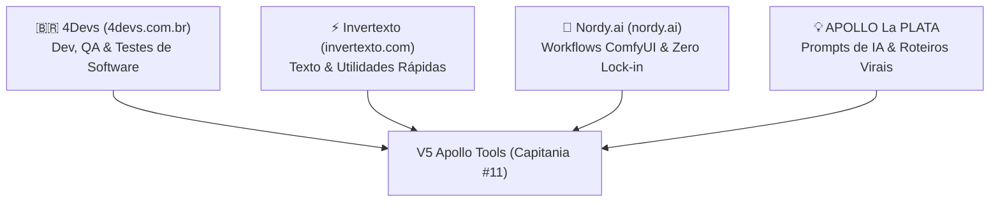

# 🛠️ MEMÓRIA ATIVA - V5 APOLLO TOOLS (CAPITANIA #11)

**Holding V5 Apollo · Repositório Local · Porta :3009**
**Data de Criação:** 25/10/2026 · **Status:** Operacional (Build 100% Green)

---

## 1. Contexto & Papel Oficial no Ecossistema

O **V5 Apollo Tools** (`E:\MEUS PROGRAMAS\V5_APOLLO_SITES\V5_Apollo_Tools`) nasceu de uma decisão estratégica deliberada pelo Comandante e pelo Agente Antigravity:
- **O Problema Resolvido:** Sites como **Apollo Edit Web** (foco em criação narrativa e consistência de personagens) e **V5 Prisma** (foco em renderização visual pesada em lote) não devem ser sobrecarregados com micro-ferramentas soltas ou catálogos dispersos. A inclusão desordenada de pequenos utilitários polui a UX e desvia o foco de cada produto.
- **A Solução:** Criar a Capitania #11 como um **Canivete Suíço Soberano**, agregando utilitários web de alta velocidade, catálogo técnico de workflows ComfyUI e geradores criativos de prompts, servindo simultaneamente como um **ímã orgânico de tráfego (SEO)** e uma oficina de suporte para os criadores da holding.

---

## 2. A Tríade Sagrada de Benchmarks de Inspiração

A pedido explícito do Comandante, o V5 Apollo Tools foi modelado para absorver e superar o que há de melhor nestas três fontes de referência:

### 1️⃣ Benchmark 1: 4Devs (`https://www.4devs.com.br`)
- **Foco:** Geradores, Validadores e Ferramentas para Desenvolvedores e Testes de QA.
- **Ferramentas Catalogadas para Absorção:**
  - `Gerador e Validador de CPF`: Cálculo com algoritmo oficial da Receita Federal (dígitos verificadores módulo 11), com ou sem pontuação (`000.000.000-00`), com filtro opcional por estado de emissão.
  - `Gerador e Validador de CNPJ`: Geração de CNPJ válido para testes de checkout e faturamento B2B.
  - `Gerador de Pessoas / Dados Fictícios de QA`: Gera nome, idade, sexo, CPF, RG, data de nascimento, celular, e-mail e endereço fictício para testes de cadastro.
  - `Validador de Cartão de Crédito (Algoritmo de Luhn)`: Testa se a numeração é matematicamente válida e identifica a bandeira (Visa, Mastercard, Elo, Amex).
  - `Gerador de CEP e Endereço Fictício`: Gera dados de logradouro válidos para preenchimento automático em testes de frete.
  - `Gerador de Contas Bancárias Fictícias`: Gera agência e conta com dígito verificador para os principais bancos (Banco do Brasil, Bradesco, Itaú, Caixa).
  - `Gerador de Senhas Fortes`: Gera senhas criptograficamente seguras com seletor de tamanho, caracteres especiais, números e maiúsculas.
  - `Formatador & Minificador de JSON / SQL / XML`: Formatação com indentação customizável e minificação de payloads.

### 2️⃣ Benchmark 2: Invertexto (`https://www.invertexto.com`)
- **Foco:** Micro-Ferramentas de Manipulação de Texto e Utilidades Rápidas do Dia a Dia.
- **Ferramentas Catalogadas para Absorção:**
  - `Contador de Caracteres & Palavras` *(Já implementado)*: Caracteres, palavras, linhas, parágrafos, tempo de leitura humana e tempo de locução para o V5 Sound.
  - `Transformador de Caixa Alta / Baixa` *(Já implementado)*: MAIÚSCULAS, minúsculas, Primeira Letra, Título, Inverter e URL Slug.
  - `Gerador de QR Code Pix & Copia e Cola` *(Já implementado)*: Padrão oficial EMVCo BR Code do BACEN com download PNG.
  - `Gerador de Link Direto de WhatsApp`: Criação de links `wa.me/55...` com mensagem personalizada pré-preenchida e codificada em URL.
  - `Limpador de Linhas & Duplicatas`: Remove linhas em branco, remove duplicatas, remove espaços extras e ordena alfabeticamente.
  - `Inversor de Texto`: Inverte caracteres ou palavras para brincadeiras e testes.
  - `Slugifier`: Transforma qualquer título ou frase em um slug amigável para SEO e URLs limpas.

### 3️⃣ Benchmark 3: Nordy.ai (`https://nordy.ai` e `nordy.ai/community/workflows`)
- **Foco:** Catálogo de Elite de Workflows ComfyUI e IA Generativa.
- **Ferramentas Catalogadas para Absorção:**
  - `Face Swap ReActor + InsightFace` *(Já catalogado)*: Troca de rosto sem perda de expressão.
  - `IDM-VTON Virtual Try-On` *(Já catalogado)*: Troca realista de roupas em modelos humanos para lojas e e-commerce.
  - `IC-Light Relighting` *(Já catalogado)*: Mudança de iluminação de estúdio e remoção de fundo com integração de luz.
  - `Flux 2 Dev + UltraSharp 4K Upscale` *(Já catalogado)*: Geração base com upscale unificado in-node em apenas 38s na H100.
  - `Wan 2.1 Video Generator` *(Já catalogado)*: Geração de vídeo cinematográfico com controle de movimento e câmera.
  - `LivePortrait Animação Facial` *(Já catalogado)*: Retratos estáticos que ganham vida com vídeo ou áudio guia.
  - `Fotografia de Produto Comercial` *(Já catalogado)*: Renderização de estúdio e mesa realista para catálogos.
  - **Soberania Nordy.ai:** Visualização dos nós principais, guia de parâmetros e **download de JSON de API do ComfyUI com 1 clique (Zero Lock-in)**.

### 4️⃣ Pilar Criativo: APOLLO La PLATA Ferramentas
- **Origem:** Pasta local `APOLLO La PLATA Ferramentas/` (`index.html`, `script.js`).
- **Ferramentas para Migração:**
  - Refinador de Prompts Cinematográficos.
  - Gerador de Títulos Virais de Alta Taxa de Clique (CTR).
  - Prompts Estruturados para Veo 3 / Sora / Kling.
  - Gerador de Roteiros Curtos (30s a 60s) com Hooks de Retenção.
  - Gerador de Hashtags Segmentadas por Nicho.

---

## 3. Estado Atual da Implementação

### 📦 Estrutura de Arquivos
- **Framework:** Next.js 14.2.35 (App Router, TypeScript).
- **Estilização:** Tailwind CSS (Paleta Cyber Obsidian com Slate 950 e bordas Slate 800/80).
- **Ícones:** Lucide React.
- **QR Code:** `qrcode.react` (Renderizador vetorial SVG e exportador Canvas).

### 🛠️ Ferramentas Ativas na Interface (100% Interativas)
1. **Contador de Caracteres (`CharacterCounter.tsx`)**: Métricas de texto, tempo de leitura e tempo de fala para V5 Sound.
2. **Conversor de Maiúsculas & Minúsculas (`CaseConverter.tsx`)**: Conversão para 6 formatos de texto e slug.
3. **Gerador de QR Code Pix (`PixQrCodeGenerator.tsx`)**: Padrão oficial BACEN EMVCo, Copia e Cola e download PNG.
4. **Gerador e Validador de CPF / CNPJ (`CpfCnpjTool.tsx`)**: Módulo 11 da Receita Federal com estado de emissão.
5. **Gerador de Pessoas para Testes QA (`FakePersonGenerator.tsx`)**: Massa de testes completa (nome, CPF válido, RG, CEP, endereço, celular e exportação JSON/CSV).
6. **Limpador de Linhas & Duplicatas (`LineCleaner.tsx`)**: Deduplicação, trim, ordenação A-Z/Z-A e estatísticas de linhas.
7. **Gerador de Link do WhatsApp (`WhatsAppLinkGenerator.tsx`)**: Link `wa.me` com mensagem, preview nativo de chat e QR Code.
8. **Cartão de Crédito Validador & Gerador QA (`CreditCardValidator.tsx`)**: Algoritmo de Luhn (Módulo 10), detecção de bandeira e dados de checkout fictícios.
9. **Gerador de Senhas Seguras & Entropia (`PasswordGenerator.tsx`)**: Criptografia nativa (`crypto.getRandomValues`), entropia em bits e estimativa de tempo contra força bruta.
10. **Formatador & Validador de JSON (`JsonFormatter.tsx`)**: Validação sintática em tempo real, indentação 2/4 espaços, minificação e cálculo de bytes salvos.
11. **Refinador de Prompts Cinematográficos (`PromptCrafter.tsx`)**: Engenharia de prompts com lentes, iluminação, estilos e presets para Flux, Midjourney e Vídeo.
12. **Gerador de Títulos Virais & CTR (`ViralTitleGenerator.tsx`)**: Fórmulas comprovadas de YouTube, Reels e TikTok com pontuação de CTR e gatilhos mentais.
13. **Catálogo de Workflows ComfyUI (`ComfyWorkflowModal.tsx`)**: Modal com visualização de nós e download de JSON de API estilo Nordy.ai.

---

## 4. Diretrizes Arquiteturais & Regras Absolutas

1. **PROIBIÇÃO TOTAL DO PIXDROP:** O PixDrop (`pixdrop.com.br`) opera isoladamente no mercado cinza. Nenhuma menção, link ou referência ao PixDrop deve existir no código do V5 Tools.
2. **FINES É O MEGAZORD DE OFERTAS:** O Fines/Finders é a plataforma de mineração e divulgação de afiliados. Não criar ferramentas que tentem substituí-lo.
3. **NÃO TOCAR EM V5 ACADEMY:** A pasta `E:\MEUS PROGRAMAS\V5_APOLLO_SITES\V5_Apollo_Academy` pertence a outro agente.
4. **DESENVOLVIMENTO LOCAL (PORTA 3009):** Mantenha o projeto rodando localmente sem provisionar Vercel ou Supabase desnecessariamente.
5. **EXECUÇÃO DE GPU FUTURA:** Quando o usuário quiser apertar "Executar no Cloud" para os workflows ComfyUI, a requisição deve ser enviada para a `V5_APOLLO_API` e não executada localmente no Next.js.
6. **AUTOR DOS COMMITS:** Sempre assinar commits como:
   `git -c user.name="Apollo La Plata" -c user.email="v5estudio@hotmail.com" commit -m "..."`

---

## 5. Roadmap Priorizado de Implementação

### 🚀 Sprint 1: Absorção 4Devs & Invertexto (100% Client-Side)
- [x] **Gerador e Validador de CPF / CNPJ (`CpfCnpjTool.tsx`):** Cálculo de dígitos verificadores oficiais, com opção de máscara e validação em tempo real.
- [x] **Gerador de Pessoas para Testes (`FakePersonGenerator.tsx`):** Gerador de massa de dados fictícios para QA com exportação JSON/CSV.
- [x] **Gerador de Link do WhatsApp (`WhatsAppLinkGenerator.tsx`):** Criação de link `wa.me/55...` com texto codificado, preview de chat e QR Code.
- [x] **Limpador de Linhas & Duplicatas (`LineCleaner.tsx`):** Deduplicação, trim, ordenação A-Z e estatísticas.
- [x] **Validador & Gerador de Cartão de Crédito (`CreditCardValidator.tsx`):** Verificação pelo algoritmo de Luhn (Módulo 10) e cartão visual de testes.
- [x] **Formatador e Validador de JSON (`JsonFormatter.tsx`):** Indentação, minificação e detecção de erros sintáticos.
- [x] **Gerador de Senhas Seguras (`PasswordGenerator.tsx`):** Chaves criptográficas de alta entropia.
- [ ] **Gerador de CEP e Endereço Fictício (`CepAddressGenerator.tsx`):** Logradouros por estado para frete.

### 🤖 Sprint 2: Migração do Acervo APOLLO La PLATA Ferramentas
- [x] Componente `PromptCrafter.tsx`: Refinador cinematográfico com câmeras, iluminação e suporte a Flux / Midjourney / Sora.
- [x] Componente `ViralTitleGenerator.tsx`: Ganchos e títulos de alta retenção (CTR) com fórmulas psicológicas e estimativa de score.
- [ ] Componente `VideoPromptCrafter.tsx`: Prompts para Veo 3 / Sora / Kling com blocos de áudio diegético.
- [ ] Componente `HashtagGenerator.tsx`: Gerador de tags segmentadas por nicho e volume.
- [ ] Componente `VideoPromptCrafter.tsx`: Prompts para Veo 3 / Sora / Kling com blocos de áudio diegético.
- [ ] Componente `HashtagGenerator.tsx`: Gerador de tags segmentadas por nicho e volume.

### ⚡ Sprint 3: Visualizador Avançado de Nós ComfyUI
- [ ] Renderização dinâmica de grafos com conexões de fios (ReactFlow/SVG) inspirada na interface do Nordy.ai.
