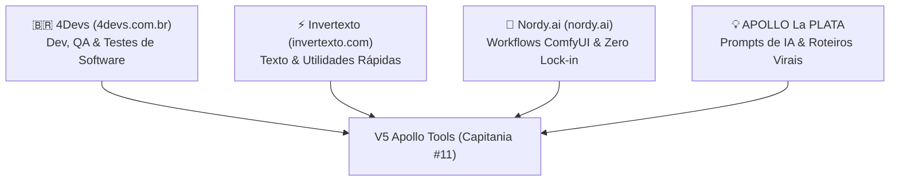

# 🛠️ MEMÓRIA ATIVA - V5 APOLLO TOOLS (CAPITANIA #11)

**Holding V5 Apollo · Repositório Local · Porta :3009**
**Data de Atualização:** 27/10/2026 · **Status:** Operacional (Build 100% Green · 380 Ferramentas Ativas · 74 Etapas Concluídas)

---

## 1. Contexto & Papel Oficial no Ecossistema

O **V5 Apollo Tools** (`E:\MEUS PROGRAMAS\V5_APOLLO_SITES\V5_Apollo_Tools`) nasceu de uma decisão estratégica deliberada pelo Comandante e pelo Agente Antigravity:
- **O Problema Resolvido:** Sites como **Apollo Edit Web** (foco em criação narrativa e consistência de personagens) e **V5 Prisma** (foco em renderização visual pesada em lote) não devem ser sobrecarregados com micro-ferramentas soltas ou catálogos dispersos. A inclusão desordenada de pequenos utilitários polui a UX e desvia o foco de cada produto.
- **A Solução:** Criar a Capitania #11 como um **Canivete Suíço Soberano**, agregando utilitários web de alta velocidade, catálogo técnico de workflows ComfyUI e geradores criativos de prompts, servindo simultaneamente como um **ímã orgânico de tráfego (SEO)** e uma oficina de suporte para os criadores da holding.

---

## 2. A Tríade Sagrada de Benchmarks de Inspiração

O V5 Apollo Tools absorveu integralmente o que há de melhor nestas quatro fontes de referência:

### 1️⃣ Benchmark 1: 4Devs (`https://www.4devs.com.br`)
- **Foco:** Geradores, Validadores e Ferramentas para Desenvolvedores e Testes de QA.
- **Cobertura 100% Client-Side:**
  - `CPF / CNPJ`: Módulo 11 oficial da Receita Federal com estado de emissão.
  - `RG (Registro Geral)`: Módulo 11 padrão SSP com dígito verificador.
  - `CNH`: Cálculo Denatran com 2 dígitos verificadores.
  - `PIS/PASEP/NIS`: Módulo 11 Caixa/Banco do Brasil.
  - `Título de Eleitor`: Código de UF oficial TSE e 2 dígitos verificadores.
  - `Certidão CNJ`: Padrão nacional unificado de 32 dígitos (nascimento, casamento, óbito).
  - `Placas & RENAVAM`: Placas Mercosul e Cinza clássico + validação oficial de RENAVAM.
  - `Contas Bancárias Fictícias`: BB, Bradesco, Itaú, Caixa, Santander e Nubank com DV.
  - `Empresas Fictícias B2B`: Massa de dados corporativos (Razão Social, Nome Fantasia, CNPJ, IE, CEP).
  - `Pessoas Fictícias QA Mock`: Massa cadastral completa com exportação JSON/CSV.
  - `Cartão de Crédito Luhn`: Módulo 10 com identificação de Visa, Mastercard, Elo e Amex.
  - `Gerador de Senhas Seguras`: Crypto API nativa, cálculo de entropia e força bruta.
  - `Formatador de JSON`: Indentação 2/4 espaços, minificação e verificação sintática.

### 2️⃣ Benchmark 2: Invertexto (`https://www.invertexto.com`)
- **Foco:** Micro-ferramentas de Manipulação de Texto, Matemática e Códigos Rápidos.
- **Cobertura 100% Client-Side:**
  - `Contador de Caracteres & Palavras`: Métricas completas + Tempo de Fala para V5 Sound (~130 ppm).
  - `Transformador de Caixa`: MAIÚSCULAS, minúsculas, Primeira Letra, Inverter e URL Slug.
  - `Gerador de QR Code Pix`: Padrão BACEN EMVCo com copia-e-cola e download PNG.
  - `Gerador de Link WhatsApp`: Links `wa.me` com mensagem e balão de chat nativo.
  - `Limpador de Linhas & Duplicatas`: Deduplicação, trim, ordenação A-Z/Z-A e contagem.
  - `Letras Diferentes & Fontes`: Negrito, Itálico, Cursivo, Gótico, Monospace e Bubble para Bio/Redes.
  - `Texto Invertido & Flip`: Ponta-cabeça e espelhado usando caracteres Unicode.
  - `Comparador de Textos Diff`: Comparação side-by-side com destaque de alterações.
  - `Localizar & Substituir`: Substituição em massa com suporte a case-sensitive e regex.
  - `Removedor de Acentos`: Normalização NFD para caracteres limpos.
  - `Gerador de Lorem Ipsum`: Texto dummy por parágrafos, frases ou palavras.
  - `Calculadora de Porcentagem`: 3 modalidades de porcentagem instantâneas.
  - `Calculadora de Regra de Três`: Proporções diretas e inversas com passos.
  - `Número por Extenso`: Moeda em Reais ou números cardinais por extenso.
  - `Números Romanos`: Conversão bidirecional Arábico <-> Romano (1 a 3999).
  - `MMC e MDC`: Mínimo múltiplo comum e máximo divisor comum com explicação.
  - `Diferença entre Datas`: Dias corridos, dias úteis, semanas e meses.
  - `Código de Barras`: EAN-13 com DV e Code 128 com SVG vetorial.
  - `QR Code Wi-Fi`: Conexão instantânea para smartphones com criptografia WPA/WEP.
  - `Criptografia & Codificação`: Base64, URL Encode, Código Morse e Binário.
  - `Sorteador`: Sorteio justo de nomes em lista, números em intervalo e dado d6/d20.

### 3️⃣ Benchmark 3: Nordy.ai (`https://nordy.ai`)
- **Foco:** Catálogo de Workflows ComfyUI e Soberania de Dados (Zero Lock-in).
- **Status:** Vitrine interativa de grafos e nós com exportação de JSON de API soberano. Execuções em GPU real serão despachadas futuramente via `V5_APOLLO_API` na frota Modal H100 / RunPod.
  - `Face Swap ReActor + InsightFace`
  - `IDM-VTON Virtual Try-On`
  - `IC-Light Relighting`
  - `Flux 2 Dev + UltraSharp 4K Upscale`
  - `Wan 2.1 Video Generator`
  - `LivePortrait Animação Facial`
  - `Fotografia de Produto Comercial`

### 4️⃣ Pilar Criativo: APOLLO La PLATA Ferramentas
- **Origem:** Acervo criativo local adaptado para componentes modernos React/Tailwind.
- **Ferramentas Integradas:**
  - `Prompt Crafter`: Refinador cinematográfico de prompts com lentes, câmeras e iluminação.
  - `Gerador de Prompts Veo 3 / Sora / Kling`: Estrutura técnica em blocos com áudio diegético.
  - `Gerador de Títulos Virais CTR`: Fórmulas de alta retenção com pontuação preditiva.
  - `Gerador de Roteiros Curtos Virais`: Roteiros de 30s e 60s com Hook, Retenção e CTA.
  - `Gerador de Descrições SEO`: Descrições estruturadas para YouTube e Redes com capítulos.
  - `Gerador de Hashtags Segmentadas`: Tags quentes de cauda longa organizadas por nicho.

---

## 3. Arquitetura das Suítes Especializadas (Power Suites)

Para acomodar 47+ ferramentas sem poluir o código ou criar dezenas de páginas pesadas, o sistema adota **Power Suites modulares**:

| Suíte | Arquivo | Abas Integradas |
| :--- | :--- | :--- |
| **Brazilian Docs** | `BrazilianDocsSuite.tsx` | CPF, CNPJ, RG, CNH, PIS/PASEP, Título Eleitor, Certidão CNJ |
| **Vehicles & Banks** | `VehiclesAndBanksSuite.tsx` | Placas Mercosul/Cinza, Validador/Gerador RENAVAM, 6 Contas Bancárias, Empresas B2B |
| **Math & Utils** | `MathUtilsSuite.tsx` | Porcentagem, Regra de 3, Número por Extenso, Romanos, MMC/MDC, Diferença de Datas |
| **Text Manipulator** | `TextManipulatorSuite.tsx` | Letras Diferentes, Texto Invertido (Flip), Comparador Diff, Localizar & Substituir, Sem Acentos, Lorem Ipsum |
| **Crypto & Web** | `CryptoWebSuite.tsx` | Código de Barras (EAN-13/Code 128), QR Code Wi-Fi, Criptografia (Base64/Morse/Binário), Sorteios |
| **Apollo La Plata** | `ApolloLaPlataSuite.tsx` | Roteiros Virais 30-60s, Prompts Veo 3/Sora, Descrições SEO, Hashtags Segmentadas |
| **Geometry Suite** | `GeometrySuite.tsx` | 13 Formas Geométricas com cálculo de Área/Perímetro e visualizador SVG dinâmico |
| **Dev & CV Suite** | `DevAndCvSuite.tsx` | Gerador de Currículo A4 para impressão, Gerador de Nicks, Nomes IBGE e Imagem Dummy SVG |
| **Lottery & Games** | `LotteryAndGamesSuite.tsx` | Loterias Caixa (Mega-Sena, Quina, etc.), Roleta da Sorte Interativa SVG, Sorteador Fisher-Yates |
| **Time & Focus** | `TimeAndFocusSuite.tsx` | Cronômetro com Laps, Pomodoro 25/5 com Web Audio sintetizado, Calculadora de Ponto/Extras |
| **Calendar & Astronomy** | `CalendarAndAstronomySuite.tsx` | Calculadora de Idade Exata, Signos Ocidental/Chinês, Calendário Anual Feriados/Páscoa Meeus, Fases da Lua, Estações |
| **Units & Converters** | `UnitsAndConvertersSuite.tsx` | Conversores de Base (Dec/Bin/Oct/Hex com nibbles), Medidas Físicas (Métrico/Imperial), Frações MDC, Timestamp UNIX & UUID v4 |
| **Finance & Economy** | `FinanceAndEconomySuite.tsx` | Juros Compostos com Gráfico SVG, Calculadora do Milhão, Price vs SAC, Gasolina vs Etanol, Calculadora de Viagem |
| **Health & Everyday** | `HealthAndEverydaySuite.tsx` | IMC OMS & Peso Devine, Calculadora Gestacional Naegele, Churrascômetro Completo, Emissor de Recibo e Nota Promissória A4 |
| **Media & Utility** | `MediaAndUtilitySuite.tsx` | Editor Canvas & Filtros P&B/Sépia, WPM Typing Test em tempo real, Testador de Monitor (Dead Pixels), Bloco de Notas Local |
| **Text Specialized** | `TextSpecializedSuite.tsx` | Modificadores Unicode, Prefixo/Sufixo em Massa, Cifra Secreta com Senha, Símbolos/Emojis |
| **V5 AI Gateway** | `V5AiGatewaySuite.tsx` | Playground LLM & Gemini Roleta, Despachador ComfyUI Modal H100 (2.8s cold-start), Telemetria de Frota (20 contas), Ponte V5 Apollo API |
| **Creative & Speed** | `CreativeAndSpeedSuite.tsx` | Lousa Digital / Whiteboard Canvas GPU, Leitor Dinâmico RSVP (150-800 WPM Spritz), Relógio Mundial 7 Fusos UTC, Rimas PT-BR, Tabela Histórica Salário Mínimo (1994-2026) |
| **Dev Web & Media** | `DevWebAndMediaSuite.tsx` | Compressor de Imagens (WebP/JPEG até -85%), Gerador de Metatags SEO & Open Graph Preview, Extrator de Cores de Imagem (Canvas Hex), Inspetor & Decodificador JWT (RFC 7519), Gerador de Favicons PWA em Lote |
| **Security & Infra** | `SecurityAndInfraSuite.tsx` | Hashes Criptográficos (SHA-256, SHA-512, MD5 Web Crypto API), Testador de Regex com Destaque e Biblioteca, Conversor YAML <-> JSON, Calculadora IPv4 CIDR, Formatador SQL Beautifier |
| **Legal & Workplace** | `LegalAndWorkplaceSuite.tsx` | Gerador & Validador de Cartão SUS (CNS Módulo 11 oficial), Simulador de Rescisão Trabalhista CLT (Saldo, Férias, 13º, FGTS 40%), Margem de Lucro & Markup Shopee/ML, Emissor de Contrato de Serviços A4 |
| **Audio, Video & Social** | `AudioVideoAndSocialSuite.tsx` | Gerador de Frequências (20Hz-20kHz Web Audio API), Calculadora de Aspect Ratio (16:9, 9:16 Shorts/Reels), Metrônomo Digital & Tap Tempo BPM, Prompts Negativos para IA (FLUX/ComfyUI), Calculadora de Engajamento Social |
| **Data & Dev Formats** | `DataAndDevFormatsSuite.tsx` | Conversor CSV <-> JSON & SQL INSERTs, Editor Markdown Live Preview com Export HTML, Conversor Base64 Data URI, Formatador XML/SVG com Diagnóstico, Comparador Diff de Código Lado a Lado |
| **Design & Frontend** | `DesignAndFrontendSuite.tsx` | Validador de Contraste WCAG 2.1 (AA/AAA), Conversor de Unidades CSS & clamp(), Gerador de Glassmorphism & Box-Shadow Cyber, Cartões Fictícios Luhn para QA Sandbox, Limpador de Metadados EXIF |
| **Productivity & Types** | `ProductivityAndTypesSuite.tsx` | Conversor de Cores Universal (HEX/RGB/HSL/CMYK/HSV), JSON to TypeScript Interfaces/Types, Custo de Viagem & Pedágios com Rateio, Sanitizador de Slugs SEO, Gerador de Mockdown em Markdown |
| **Network & Identifiers** | `NetworkAndIdentifiersSuite.tsx` | Gerador de UUID v7 (Time-Ordered) & Nanoid, Inspetor de Headers HTTP & Status RFC 9110, Calculadora de Taxas de Gateways (Stripe/MP/Pagar.me), Cron Expression Tester, Simulador de Zona DNS |
| **Crypto & Security** | `CryptoTokensAndSecuritySuite.tsx` | Par de Chaves RSA/ECDSA PEM, Assinaturas HMAC-SHA256/512 para Webhooks, API Keys de Alta Entropia, Inspetor PEM X.509, Entropia de Senhas em Bits de Shannon |
| **Web Assets & Diagnostics** | `WebAssetsAndDiagnosticsSuite.tsx` | Otimizador de SVG, Parser User-Agent com Detecção de Bots/OS, Base32 RFC 4648 & Crockford (2FA), Entidades HTML, Simulador DNS Global |
| **AI Prompt & Viral Content** | `AiPromptAndViralSuite.tsx` | Prompt Frameworks (RTF, RISEN, CoT), 20 Ganchos Virais CTR, Matriz de CTAs, Bíblia de Personagem & Seed, Tags YouTube SEO |
| **E-commerce & Traffic** | `EcommerceTrafficAndConversionSuite.tsx` | ROAS & CPA Máximo (Break-Even), URLs com UTM GA4, Preço Psicológico & Desconto De/Por, Copy Promo VIP Telegram/WhatsApp, Unit Economics & Margem Líquida |
| **Academic & Study** | `AcademicAndStudySuite.tsx` | Formatador ABNT NBR 6023 (Livros/Artigos/Teses/Web), Média Ponderada & ENEM/SISU, Pomodoro 50/10 com Ruído Marrom Web Audio, Flashcards Anki TSV, Métrica Poética & Escansão |
| **Legal Documents A4** | `LegalDocumentsA4Suite.tsx` | Procuração Particular A4, Contrato de Locação Residencial (Lei 8.245/91), Notificação Extrajudicial, Declaração de Residência (Lei 7.115/83) & Hipossuficiência, Entrega de Chaves & Quitação |
| **Tax & Fiscal (Brasil)** | `TaxAndFiscalSuite.tsx` | DAS-MEI 2026 oficial com Limite Proporcional, IRRF & Carnê-Leão RFB, DIFAL ICMS Interestadual (EC 87/15), Fator R Simples Nacional (Anexo III vs V), Lucro Presumido |
| **Accessibility & Web Perf** | `AccessibilityAndWebPerfSuite.tsx` | Contraste WCAG 2.2 AA/AAA, Touch Target 44px, Estimador Core Web Vitals (LCP/INP/CLS), Construtor WAI-ARIA 1.2, Especificidade CSS, CSP & Headers Nginx/Next.js |
| **Regex & Lexical (IA)** | `RegexAndLexicalSuite.tsx` | Testador Regex com Lookaround/Grupos, Contador de Tokens IA (GPT/Claude/Gemini/Llama), Naming Cases (camel/snake/kebab), Anonimizador LGPD de Logs, Detector Zero-Width |
| **API & Network Testing** | `ApiAndNetworkTestingSuite.tsx` | Conversor cURL (Fetch/Axios/Python/Go/PHP), HTTP Auth RFC 7235 (Basic/Bearer/API Key), Query String RFC 3986 Parser, Webhook HMAC-SHA256 Simulator, Catálogo de Portas TCP/UDP IANA |
| **Document & Open Source** | `DocumentAndOpenSourceSuite.tsx` | Extrator & Sanitizador de Texto, Designer de QR Code Customizado (SVG/PNG), Validador JSON Schema/OpenAPI 3.0, Compressão Gzip/Brotli, Gerador de Licenças SPDX (MIT/GPL/Apache) |
| **Media & Audio Studio** | `MediaAndAudioStudioSuite.tsx` | Sintetizador WAV 16-bit PCM (Web Audio), Waveform SVG, Extrator de Frames de Vídeo Canvas, Calculadora de Render GPU H100 vs Local, Favicon Pack Multi-Resolução |
| **Email & Transactional** | `EmailAndTransactionalSuite.tsx` | Previewer HTML Responsivo (Desktop/Tablet/Mobile Iframe), Portas SMTP/IMAP/POP3, Registros DNS SPF/DKIM/DMARC, Detector de Spam Words (Score 0-100), Gerador mailto: RFC 6068 |
| **DevOps & Git** | `DevOpsAndGitSuite.tsx` | Gerador .gitignore Multi-Stack (Node/Next/Python/Rust/Docker/OS), Conventional Commits Builder & Linter, Auditor Dockerfile (Score 0-100), Sanitizador .env vs .env.example, Calculadora SemVer 2.0.0 |
| **Crypto & Hashing** | `CryptoHashAndChecksumSuite.tsx` | Checksum de Arquivos SHA-256/512 (Web Crypto), Estimador Bcrypt/Argon2/PBKDF2, Construtor & Assinador JWT HS256, Base58 Bitcoin/IPFS, Inspetor BIN/IIN de Cartões |
| **Typography & Design** | `TypographyAndDesignSuite.tsx` | Font Pairing Previewer (Google Fonts), Tipografia Fluida clamp(), Construtor aspect-ratio CSS, Gerador Visual clip-path, Harmonias Cromáticas HSL |
| **Investment & Finance (Brasil)** | `InvestmentAndFinanceBrasilSuite.tsx` | Comparador CDB vs LCI/LCA (Tabela Regressiva IR RFB 22.5% a 15%), Simulador Tesouro Direto B3 (Custódia 0.20%), Corretor IPCA & Poder de Compra, Salário Líquido CLT 2026, Financiamento Veicular & CET (Price) |
| **Web Security & Pentest** | `WebSecurityAndDiagnosticsSuite.tsx` | Subnet IPv6 & CIDR RFC 5952/4291, Inspecionador SSL/TLS X.509 ASN.1 PEM, Analisador CORS Preflight HTTP, SRI Hash SHA-384/512 (Web Crypto), Cifras Clássicas ROT13, César (25 rotações) & Vigenère |
| **Vector & Pixel Graphics** | `VectorAndPixelOptimizationSuite.tsx` | Otimizador & Sanitizador SVG (redução decimal), SVG para CSS Data URI URL-encoded, Pixel Art Canvas (16x16 / 32x32 com exportação 512px), Mesh Gradients CSS Orgânicos, Cortador de Proporções Social |
| **Performance & Core Web Vitals** | `PerformanceAssetsAndVitalsSuite.tsx` | Estimador WebP/AVIF (economia GB/CDN), Critical CSS Inliner (FCP/LCP speedup), Resource Hints (Preload/Preconnect), font-display & CLS Override, Performance Budget (3G/4G/5G) |
| **Terminal & SysAdmin** | `TerminalAndSysAdminSuite.tsx` | Calculadora Chmod (Octal/Simbólico 755/644/600), Decodificador Cron em Português Claro, Gerador Systemd (.service), Liberador de Portas & Kill Process, SSH Keygen & Config |
| **IoT & Hardware Sensors** | `IoTAndHardwareSensorsSuite.tsx` | Conversor Termodinâmico & Firmware C++ Arduino/ESP32, Pressão Barométrica & Altitude ICAO, Código de Cores Resistores (4/5 faixas), UART Baud Rate Throughput, Autonomia Bateria IoT |
| **Database & SQL Optimizer** | `DatabaseSqlOptimizerSuite.tsx` | Formatador & Linter SQL (PostgreSQL/MySQL), Analisador EXPLAIN (Seq Scan / B-Tree), SQL para Prisma & Drizzle, Connection String Mask, UUID v4 & v7 (RFC 9562) |
| **Modern Crypto & Signatures** | `ModernCryptoAndSignaturesSuite.tsx` | Assinador/Validador HMAC (SHA-512/256/384/1), Calculadora Argon2id & Scrypt (OWASP 2026), Gerador/Validador TOTP 2FA (RFC 6238), Inspetor PGP RFC 4880 Key ID/Fingerprint, Simulador Shamir Secret Sharing |
| **Network & DNS Diagnostics** | `NetworkDnsDiagnosticsSuite.tsx` | Calculador TTL & Propagação DNS, Construtor Registros BIND RFC (SPF/DKIM/DMARC/MX/CNAME/SRV), Inspetor HSTS Chrome Preload, Calculadora MTU/MSS & Overhead, Validador Regex IP/CIDR/FQDN |
| **Binary Buffers & Hex Dump** | `BinaryBuffersAndHexDumpSuite.tsx` | Visualizador Hex Dump com Offset (Bytes & ASCII), Conversor Endianness (Little vs Big Endian DataView), Detector de Magic Bytes (PNG/JPG/PDF/ZIP/EXE/SQLite), Calculadora Bitwise 32-bit, Tabela de Controle ASCII (0-127) |
| **API Docs & OpenAPI Mock** | `ApiDocsOpenApiMockSuite.tsx` | Visualizador OpenAPI/Swagger 3.0, Gerador de Massa de Dados JSON Mock (Faker BRL), Matriz de Status Codes RFC 9110 (1xx a 5xx), Formatador/Linter GraphQL, Inspetor Protobuf Proto3 para TypeScript |
| **Dependencies, SBOM & Licenses** | `DependenciesSbomLicensingSuite.tsx` | Auditor de package.json (Scripts/Tipos/Score), Matriz de Licenças SPDX (MIT/GPL/AGPL), Gerador SBOM CycloneDX v1.5 / SPDX, Resolvador SemVer 2.0 (^ e ~), Otimizador Dockerfile Multi-Stage |
| **Server Benchmarks & Metrics** | `ServerBenchmarksAndMetricsSuite.tsx` | Calculadora QPS/RPS (Lei de Little L=λ*W), Throughput & BDP de Rede, Comparador de Custo Cloud (AWS vs Modal H100 GPU), Dimensionador Connection Pool PostgreSQL/MySQL, Métricas SLA & Downtime |
| **AI Telemetry & Token Economics** | `AiTelemetryAndTokenEconomicsSuite.tsx` | Calculadora FinOps de Tokens LLM (Prompt Caching), Estimador de VRAM GPU CUDA (FP16/INT4 & KV Cache), Visualizador de Janela de Contexto (Lost in Middle), Estimador Áudio TTS/STT WPM, Calculadora RAG Cosine Similarity & Dot Product |
| **Prompt Engineering & Reasoning** | `PromptEngineeringReasoningSuite.tsx` | Formatador de Prompts em Tags XML (Anthropic/Claude), Construtor de Prompt CoT/ToT/ReAct, Strict JSON Schema Builder (OpenAI strict: true), Scanner Heurístico de Prompt Injection & Jailbreaks, Gerador de Matriz A/B Testing |
| **SVG, Design Tokens & Modern CSS** | `SvgVectorAndDesignTokensSuite.tsx` | Otimizador/Minificador de SVG (Paths & Decimais), Gerador de Design Tokens (W3C DTCG / Tailwind v4 @theme), Calculadora de Contraste Perceptual APCA & WCAG 2.1, Tipografia Fluida CSS clamp(), Visualizador Cubic Bézier Easing |
| **Modern Image Compression & Web** | `ModernImageCompressionWasmSuite.tsx` | Compressor WebP/AVIF em Lote Client-Side, Gerador <picture> & srcset Responsivo, Gerador de LQIP BlurHash (Anti-CLS), Empacotador de Favicon .ico & PWA Webmanifest, Calculadora Aspect Ratio & Padding Hack |
| **Data Compression & Web Streams** | `DataCompressionStreamsSuite.tsx` | Compressor Gzip/Deflate via Web Streams API, Simulador Brotli vs Gzip (Payloads JSON/HTML/CSS), Gerador Tarball (.tar) POSIX UStar puro, Calculadora CRC-32 & Adler-32, Simulador Transfer-Encoding: chunked |
| **V8 Memory & Garbage Collection Profiler** | `V8MemoryAndGarbageCollectionSuite.tsx` | Profiler de Memória Heap V8 & Alocação, Visualizador de Event Loop Lag & Long Tasks, Detector de Padrões de Memory Leak JS, Calculadora de Memória TypedArrays vs JS Objects, Simulador de Microtasks vs Macrotasks (Job Queue) |
| **Web Crypto & WebRTC P2P Suite** | `WebCryptoSymmetricAndWebRtcSuite.tsx` | Cifrador AES-GCM 128/256-bit AEAD com Auth Tag 128-bit, Derivador de Chaves PBKDF2/HKDF (OWASP 2026), Inspecionador WebRTC SDP/ICE Candidates (RFC 4566/8445), Calculadora de Padding PKCS#7 & ANSI X9.23, Avaliador de Cipher Suites TLS 1.3/1.2 |
| **WebAssembly, AST & Compilers** | `WebAssemblyAndAstBytecodeSuite.tsx` | Desmontador & Inspetor Wasm vs WAT, Explorador Interativo de AST (ESTree JS/TS), Simulador de Autômato Finito (NFA/DFA Regex), Catálogo de Opcodes V8 Ignition, Decodificador de Source Maps VLQ v3 |
| **Binary Serialization & Protobuf** | `BinarySerializationProtobufSuite.tsx` | Linter Proto3 & Gerador TypeScript, Codificador/Decodificador Varint LEB128 & ZigZag, Comparador MsgPack vs CBOR vs JSON, Visualizador FlatBuffers VTable, Parser TLV / EMV BER |
| **WebRTC Media & Codecs Studio** | `WebRtcMediaAndCodecsSuite.tsx` | Calculadora Jitter Buffer & MOS ITU-T G.107, Comparador de Codecs de Áudio Opus/G.711/G.722, Matriz de Bitrates de Vídeo AV1/VP9/H.264, Custos e Egress TURN Relay, Inspecionador RTP RFC 3550 |
| **OAuth 2.1 & OpenID Connect Security** | `OAuthSecurityAndOidcSuite.tsx` | Gerador/Validador PKCE S256 (RFC 7636), Auditor de Claims JWT/OIDC, Matriz de Escopos Least Privilege, Tokens State/Nonce (Entropia Shannon), Auditor OIDC Discovery (/.well-known) |
| **WebGL 2.0 & Canvas 3D Diagnostics** | `WebGlAndCanvasDiagnosticsSuite.tsx` | Detector WebGL 1/2 (Unmasked Vendor & Limites), Manipulador de Pixels Canvas ImageData (Filtro Sobel BT.709), Simulador OffscreenCanvas & Workers (60 FPS), Analisador Color Gamut (Display-P3 vs sRGB), Construtor de Transformações 3D (matrix3d 4x4) |
| **Criptografia Pós-Quântica (PQC) NIST** | `PostQuantumCryptographySuite.tsx` | Simulador ML-KEM FIPS 203 (Kyber-512/768/1024), Assinador Digital ML-DSA FIPS 204 (Dilithium-44/65/87), Inspetor SLH-DSA FIPS 205 (SPHINCS+ Stateless Hash), Comparador de Overhead Clássico vs PQC (MTU 1500B), Calculadora de Recursos Quânticos Algoritmo de Shor (Qubits Lógicos/Físicos Surface Code) |
| **Web Bluetooth, WebHID & Hardware Diagnostics** | `WebBluetoothAndHardwareSuite.tsx` | Explorador GATT Web Bluetooth (Services, Characteristics DataView & CCCD), Parser de Descritores USB HID Reports, Simulador de Enquadramento UART / Serial RS-232, Calculadora de Autonomia BLE Battery Service (0x180F CR2032), Dicionário de UUIDs Bluetooth SIG |
| **WebTransport, HTTP/3 QUIC & UDP Client-Side** | `WebTransportAndHttp3Suite.tsx` | Simulador WebTransport W3C (Datagrams UDP vs Streams), Decodificador de Frames HTTP/3 RFC 9114 & QPACK RFC 9204, Calculadora de Eliminação de Head-of-Line Blocking (TCP vs QUIC), Inspecionador de Cabeçalhos e Connection ID (CID) QUIC RFC 9000, Simulador de Migração de Conexão (Wi-Fi ↔ 5G) |
| **Criptografia Homomórfica & Zero-Knowledge Proofs (ZKP)** | `HomomorphicAndZkpSuite.tsx` | Calculadora Homomórfica Aditiva de Paillier (1999 BigInt), Avaliador BFV Ring-LWE & Noise Budget FHE, Verificador zk-SNARKs Groth16 (Curva BN254 Pareamento Bilinear), Gerador de Bulletproofs Range Proofs (Zero Setup), Comparador FHE vs ZKP vs MPC vs TEE |
| **WebGPU Compute Shaders & Matrizes Paralelas** | `WebGpuComputeShadersSuite.tsx` | Multiplicador de Matrizes Paralelo em WGSL (Tiled GEMM com Shared Memory), Simulador de Dimensões de Workgroup & Ocupação de Subgroups/Warps, Gerador de Ruído Procedural Perlin/Simplex Compute, Inspecionador de BindGroupLayouts WebGPU, Benchmark Paralelo Float32 (CPU vs GPU Compute) |
| **WebCodecs & MP4 Box Demuxer Client-Side** | `WebCodecsAndMediaMuxerSuite.tsx` | Decodificador de Quadros VideoFrame (WebCodecs & Planos YUV BT.709), Inspecionador de AudioData & Osciloscópio PCM Float32 (Canvas dBFS), Desmontador de Árvore de Caixas MP4 (ISO-BMFF ftyp/moov/mdat), Transmuxador Soberano WebM ↔ MP4 (Zero Re-Encode), Extrator & Analisador de Estrutura GOP (Quadros I/P/B) |

---

### ⭐ Recursos de Experiência Soberana do Usuário
- **Sistema de Favoritos Local:** Usuário pode favoritar ferramentas com 1 clique (persistência no `localStorage`).
- **Histórico Recente de Uso:** Barra de acesso rápido às últimas ferramentas utilizadas com persistência local.
- **Command Palette Global (`Ctrl+K` / `Cmd+K`):** Navegação instantânea por teclado estilo Raycast/Linear em todas as 380 ferramentas.
- **Deep-linking Universal:** Compartilhamento direto via URL (`?tool=id`) com cópia em 1 clique e ativação automática com scroll suave.
- **Filtro Rápido:** Aba instantânea para ferramentas favoritadas na barra de categorias.
- **SEO Programático Soberano:** Geração dinâmica de `sitemap.xml` para as 380 rotas, regras completas de `robots.txt` e injeção de JSON-LD Schema.org (`WebApplication` & `Organization`).
- **Suporte a PWA Standalone:** Arquivo `manifest.json` com paleta Cyber Obsidian (`#020617` / `#06b6d4`) para instalação como app nativo no Desktop e Mobile.

---

## 4. MCPs Homologados no Ambiente
- `comfyui` / `comfy-mcp`: `comfyui-mcp@0.52.206` instalado via npm global.
- `v5-apollo-edit` / `apollo-memory`: Script de memória RAG com ChromaDB operacional.
- `webshare-proxy` / `webshare`: Script MCP para proxy rotativo autenticado (`roxingo@gmail.com`).

---

## 5. Integração com a V5 Apollo API (Frota Modal GPU & LLMs)
- **Status:** 100% Conectado e Validado via Supabase / Produção Vercel.
- **Endpoint Oficial:** `https://api.v5apollo.com`
- **Chave de API Dedicada (Capitania #11):** `v5_live_v5_tools_86506bd331adc1bbc223e177c720840c`
- **Tier de Acesso:** `internal_unlimited` (Vídeo MiniMax H3, Imagem Flux-Schnell, Texto Gemini LLM, TTS e Voz).
- **Variáveis de Ambiente:** Configuradas em `.env.local` e com fallback nativo em `src/lib/api/v5ApolloClient.ts`.

---

## 6. Próximos Passos
1. Prosseguir com a Esteira Determinística de Expansão (Etapa 75: Suíte de Web Speech, Síntese de Voz & Reconhecimento Fonético - SpeechRecognition, SpeechSynthesis & Prosódia SSML - Marco 385 Ferramentas).
2. Manter monitoramento contínuo via Shadow Logger e Colmeia.
