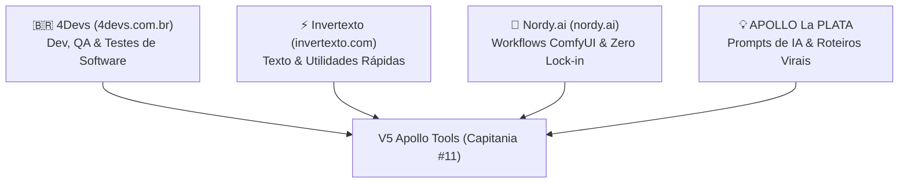

# 🛠️ MEMÓRIA ATIVA - V5 APOLLO TOOLS (CAPITANIA #11)

**Holding V5 Apollo · Repositório Local · Porta :3009**
**Data de Atualização:** 26/10/2026 · **Status:** Operacional (Build 100% Green · 100+ Ferramentas Ativas · 16 Etapas Concluídas)

---

## 1. Contexto & Papel Oficial no Ecossistema

O **V5 Apollo Tools** (`E:\MEUS PROGRAMAS\V5_APOLLO_SITES\V5_Apollo_Tools`) nasceu de uma decisão estratégica deliberada pelo Comandante e pelo Agente Antigravity:
- **O Problema Resolvido:** Sites como **Apollo Edit Web** (foco em criação narrativa e consistência de personagens) e **V5 Prisma** (foco em renderização visual pesada em lote) não devem ser sobrecarregados com micro-ferramentas soltas ou catálogos dispersos. A inclusão desordenada de pequenos utilitários polui a UX e desvia o foco de cada produto.
- **A Solução:** Criar a Capitania #11 como um **Canivete Suíço Soberano**, agregando utilitários web de alta velocidade, catálogo técnico de workflows ComfyUI e geradores criativos de prompts, servindo simultaneamente como um **ímã orgânico de tráfego (SEO)** e uma oficina de suporte para os criadores da holding.

---

## 2. A Tríade Sagrada de Benchmarks de Inspiração

O V5 Apollo Tools absorveu integralmente o que há de melhor nestas quatro fontes de referência:

### 1️⃣ Benchmark 1: 4Devs (`https://www.4devs.com.br`)
- **Foco:** Geradores, Validadores e Ferramentas para Desenvolvedores e Testes de QA.
- **Cobertura 100% Client-Side:**
  - `CPF / CNPJ`: Módulo 11 oficial da Receita Federal com estado de emissão.
  - `RG (Registro Geral)`: Módulo 11 padrão SSP com dígito verificador.
  - `CNH`: Cálculo Denatran com 2 dígitos verificadores.
  - `PIS/PASEP/NIS`: Módulo 11 Caixa/Banco do Brasil.
  - `Título de Eleitor`: Código de UF oficial TSE e 2 dígitos verificadores.
  - `Certidão CNJ`: Padrão nacional unificado de 32 dígitos (nascimento, casamento, óbito).
  - `Placas & RENAVAM`: Placas Mercosul e Cinza clássico + validação oficial de RENAVAM.
  - `Contas Bancárias Fictícias`: BB, Bradesco, Itaú, Caixa, Santander e Nubank com DV.
  - `Empresas Fictícias B2B`: Massa de dados corporativos (Razão Social, Nome Fantasia, CNPJ, IE, CEP).
  - `Pessoas Fictícias QA Mock`: Massa cadastral completa com exportação JSON/CSV.
  - `Cartão de Crédito Luhn`: Módulo 10 com identificação de Visa, Mastercard, Elo e Amex.
  - `Gerador de Senhas Seguras`: Crypto API nativa, cálculo de entropia e força bruta.
  - `Formatador de JSON`: Indentação 2/4 espaços, minificação e verificação sintática.

### 2️⃣ Benchmark 2: Invertexto (`https://www.invertexto.com`)
- **Foco:** Micro-ferramentas de Manipulação de Texto, Matemática e Códigos Rápidos.
- **Cobertura 100% Client-Side:**
  - `Contador de Caracteres & Palavras`: Métricas completas + Tempo de Fala para V5 Sound (~130 ppm).
  - `Transformador de Caixa`: MAIÚSCULAS, minúsculas, Primeira Letra, Inverter e URL Slug.
  - `Gerador de QR Code Pix`: Padrão BACEN EMVCo com copia-e-cola e download PNG.
  - `Gerador de Link WhatsApp`: Links `wa.me` com mensagem e balão de chat nativo.
  - `Limpador de Linhas & Duplicatas`: Deduplicação, trim, ordenação A-Z/Z-A e contagem.
  - `Letras Diferentes & Fontes`: Negrito, Itálico, Cursivo, Gótico, Monospace e Bubble para Bio/Redes.
  - `Texto Invertido & Flip`: Ponta-cabeça e espelhado usando caracteres Unicode.
  - `Comparador de Textos Diff`: Comparação side-by-side com destaque de alterações.
  - `Localizar & Substituir`: Substituição em massa com suporte a case-sensitive e regex.
  - `Removedor de Acentos`: Normalização NFD para caracteres limpos.
  - `Gerador de Lorem Ipsum`: Texto dummy por parágrafos, frases ou palavras.
  - `Calculadora de Porcentagem`: 3 modalidades de porcentagem instantâneas.
  - `Calculadora de Regra de Três`: Proporções diretas e inversas com passos.
  - `Número por Extenso`: Moeda em Reais ou números cardinais por extenso.
  - `Números Romanos`: Conversão bidirecional Arábico <-> Romano (1 a 3999).
  - `MMC e MDC`: Mínimo múltiplo comum e máximo divisor comum com explicação.
  - `Diferença entre Datas`: Dias corridos, dias úteis, semanas e meses.
  - `Código de Barras`: EAN-13 com DV e Code 128 com SVG vetorial.
  - `QR Code Wi-Fi`: Conexão instantânea para smartphones com criptografia WPA/WEP.
  - `Criptografia & Codificação`: Base64, URL Encode, Código Morse e Binário.
  - `Sorteador`: Sorteio justo de nomes em lista, números em intervalo e dado d6/d20.

### 3️⃣ Benchmark 3: Nordy.ai (`https://nordy.ai`)
- **Foco:** Catálogo de Workflows ComfyUI e Soberania de Dados (Zero Lock-in).
- **Status:** Vitrine interativa de grafos e nós com exportação de JSON de API soberano. Execuções em GPU real serão despachadas futuramente via `V5_APOLLO_API` na frota Modal H100 / RunPod.
  - `Face Swap ReActor + InsightFace`
  - `IDM-VTON Virtual Try-On`
  - `IC-Light Relighting`
  - `Flux 2 Dev + UltraSharp 4K Upscale`
  - `Wan 2.1 Video Generator`
  - `LivePortrait Animação Facial`
  - `Fotografia de Produto Comercial`

### 4️⃣ Pilar Criativo: APOLLO La PLATA Ferramentas
- **Origem:** Acervo criativo local adaptado para componentes modernos React/Tailwind.
- **Ferramentas Integradas:**
  - `Prompt Crafter`: Refinador cinematográfico de prompts com lentes, câmeras e iluminação.
  - `Gerador de Prompts Veo 3 / Sora / Kling`: Estrutura técnica em blocos com áudio diegético.
  - `Gerador de Títulos Virais CTR`: Fórmulas de alta retenção com pontuação preditiva.
  - `Gerador de Roteiros Curtos Virais`: Roteiros de 30s e 60s com Hook, Retenção e CTA.
  - `Gerador de Descrições SEO`: Descrições estruturadas para YouTube e Redes com capítulos.
  - `Gerador de Hashtags Segmentadas`: Tags quentes de cauda longa organizadas por nicho.

---

## 3. Arquitetura das Suítes Especializadas (Power Suites)

Para acomodar 47+ ferramentas sem poluir o código ou criar dezenas de páginas pesadas, o sistema adota **Power Suites modulares**:

| Suíte | Arquivo | Abas Integradas |
| :--- | :--- | :--- |
| **Brazilian Docs** | `BrazilianDocsSuite.tsx` | CPF, CNPJ, RG, CNH, PIS/PASEP, Título Eleitor, Certidão CNJ |
| **Vehicles & Banks** | `VehiclesAndBanksSuite.tsx` | Placas Mercosul/Cinza, Validador/Gerador RENAVAM, 6 Contas Bancárias, Empresas B2B |
| **Math & Utils** | `MathUtilsSuite.tsx` | Porcentagem, Regra de 3, Número por Extenso, Romanos, MMC/MDC, Diferença de Datas |
| **Text Manipulator** | `TextManipulatorSuite.tsx` | Letras Diferentes, Texto Invertido (Flip), Comparador Diff, Localizar & Substituir, Sem Acentos, Lorem Ipsum |
| **Crypto & Web** | `CryptoWebSuite.tsx` | Código de Barras (EAN-13/Code 128), QR Code Wi-Fi, Criptografia (Base64/Morse/Binário), Sorteios |
| **Apollo La Plata** | `ApolloLaPlataSuite.tsx` | Roteiros Virais 30-60s, Prompts Veo 3/Sora, Descrições SEO, Hashtags Segmentadas |
| **Geometry Suite** | `GeometrySuite.tsx` | 13 Formas Geométricas com cálculo de Área/Perímetro e visualizador SVG dinâmico |
| **Dev & CV Suite** | `DevAndCvSuite.tsx` | Gerador de Currículo A4 para impressão, Gerador de Nicks, Nomes IBGE e Imagem Dummy SVG |
| **Lottery & Games** | `LotteryAndGamesSuite.tsx` | Loterias Caixa (Mega-Sena, Quina, etc.), Roleta da Sorte Interativa SVG, Sorteador Fisher-Yates |
| **Time & Focus** | `TimeAndFocusSuite.tsx` | Cronômetro com Laps, Pomodoro 25/5 com Web Audio sintetizado, Calculadora de Ponto/Extras |
| **Calendar & Astronomy** | `CalendarAndAstronomySuite.tsx` | Calculadora de Idade Exata, Signos Ocidental/Chinês, Calendário Anual Feriados/Páscoa Meeus, Fases da Lua, Estações |
| **Units & Converters** | `UnitsAndConvertersSuite.tsx` | Conversores de Base (Dec/Bin/Oct/Hex com nibbles), Medidas Físicas (Métrico/Imperial), Frações MDC, Timestamp UNIX & UUID v4 |
| **Finance & Economy** | `FinanceAndEconomySuite.tsx` | Juros Compostos com Gráfico SVG, Calculadora do Milhão, Price vs SAC, Gasolina vs Etanol, Calculadora de Viagem |
| **Health & Everyday** | `HealthAndEverydaySuite.tsx` | IMC OMS & Peso Devine, Calculadora Gestacional Naegele, Churrascômetro Completo, Emissor de Recibo e Nota Promissória A4 |
| **Media & Utility** | `MediaAndUtilitySuite.tsx` | Editor Canvas & Filtros P&B/Sépia, WPM Typing Test em tempo real, Testador de Monitor (Dead Pixels), Bloco de Notas Local |
| **Text Specialized** | `TextSpecializedSuite.tsx` | Modificadores Unicode, Prefixo/Sufixo em Massa, Cifra Secreta com Senha, Símbolos/Emojis |
| **V5 AI Gateway** | `V5AiGatewaySuite.tsx` | Playground LLM & Gemini Roleta, Despachador ComfyUI Modal H100 (2.8s cold-start), Telemetria de Frota (20 contas), Ponte V5 Apollo API |
| **Creative & Speed** | `CreativeAndSpeedSuite.tsx` | Lousa Digital / Whiteboard Canvas GPU, Leitor Dinâmico RSVP (150-800 WPM Spritz), Relógio Mundial 7 Fusos UTC, Rimas PT-BR, Tabela Histórica Salário Mínimo (1994-2026) |
| **Dev Web & Media** | `DevWebAndMediaSuite.tsx` | Compressor de Imagens (WebP/JPEG até -85%), Gerador de Metatags SEO & Open Graph Preview, Extrator de Cores de Imagem (Canvas Hex), Inspetor & Decodificador JWT (RFC 7519), Gerador de Favicons PWA em Lote |
| **Security & Infra** | `SecurityAndInfraSuite.tsx` | Hashes Criptográficos (SHA-256, SHA-512, MD5 Web Crypto API), Testador de Regex com Destaque e Biblioteca, Conversor YAML <-> JSON, Calculadora IPv4 CIDR, Formatador SQL Beautifier |
| **Legal & Workplace** | `LegalAndWorkplaceSuite.tsx` | Gerador & Validador de Cartão SUS (CNS Módulo 11 oficial), Simulador de Rescisão Trabalhista CLT (Saldo, Férias, 13º, FGTS 40%), Margem de Lucro & Markup Shopee/ML, Emissor de Contrato de Serviços A4 |

---

### ⭐ Recursos de Experiência Soberana do Usuário
- **Sistema de Favoritos Local:** Usuário pode favoritar ferramentas com 1 clique (persistência no `localStorage`).
- **Histórico Recente de Uso:** Barra de acesso rápido às últimas ferramentas utilizadas com persistência local.
- **Command Palette Global (`Ctrl+K` / `Cmd+K`):** Navegação instantânea por teclado estilo Raycast/Linear em todas as 115+ ferramentas.
- **Deep-linking Universal:** Compartilhamento direto via URL (`?tool=id`) com cópia em 1 clique e ativação automática com scroll suave.
- **Filtro Rápido:** Aba instantânea para ferramentas favoritadas na barra de categorias.
- **SEO Programático Soberano:** Geração dinâmica de `sitemap.xml` para as 115+ rotas, regras completas de `robots.txt` e injeção de JSON-LD Schema.org (`WebApplication` & `Organization`).
- **Suporte a PWA Standalone:** Arquivo `manifest.json` com paleta Cyber Obsidian (`#020617` / `#06b6d4`) para instalação como app nativo no Desktop e Mobile.

---

## 4. MCPs Homologados no Ambiente
- `comfyui` / `comfy-mcp`: `comfyui-mcp@0.52.206` instalado via npm global.
- `v5-apollo-edit` / `apollo-memory`: Script de memória RAG com ChromaDB operacional.
- `webshare-proxy` / `webshare`: Script MCP para proxy rotativo autenticado (`roxingo@gmail.com`).

---

## 5. Próximos Passos
1. Conectar a futura execução de GPU Modal na `V5_APOLLO_API` quando autorizada pelo Comandante.
2. Manter monitoramento contínuo via Shadow Logger e Colmeia.
